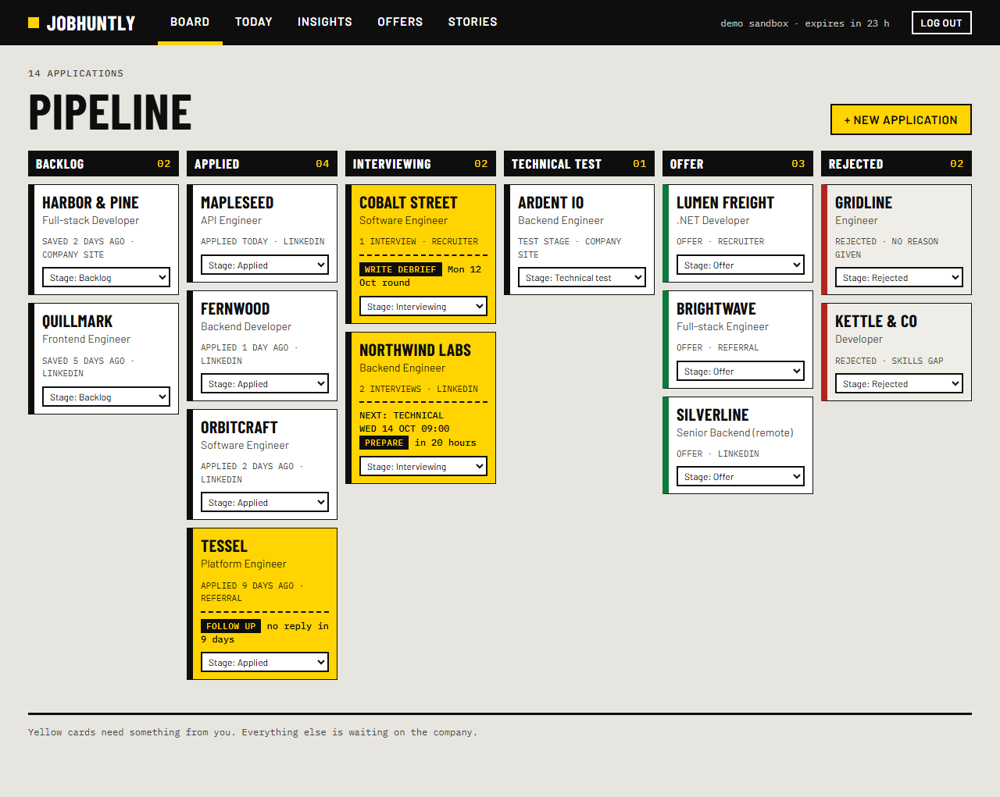
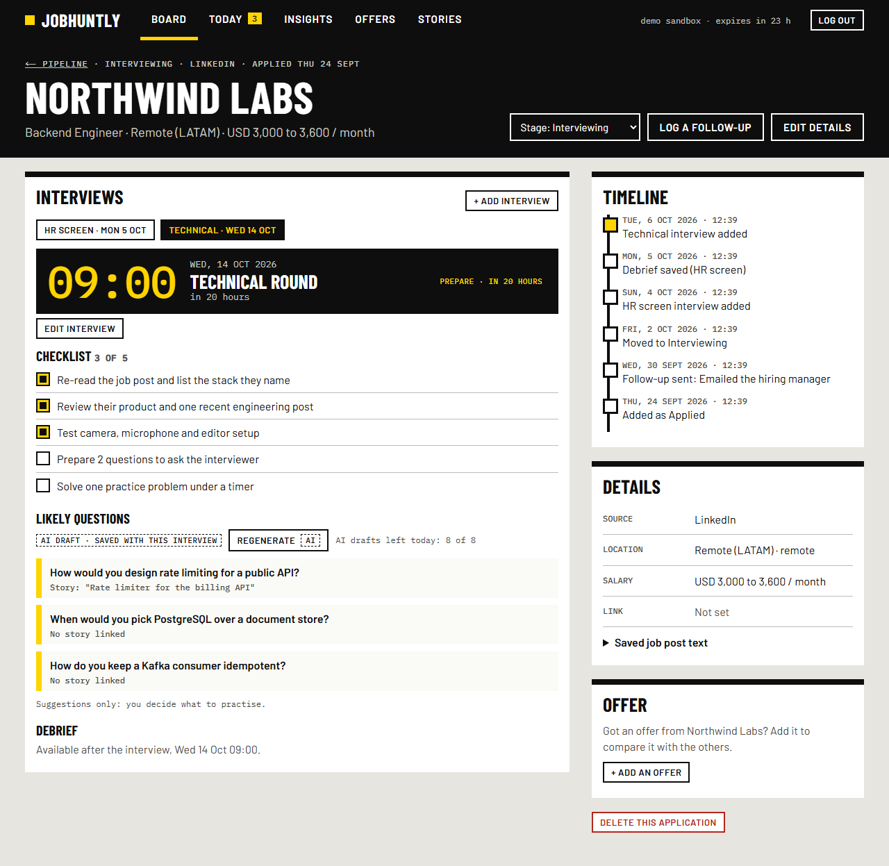
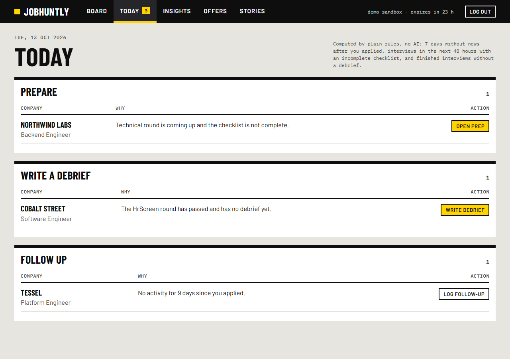
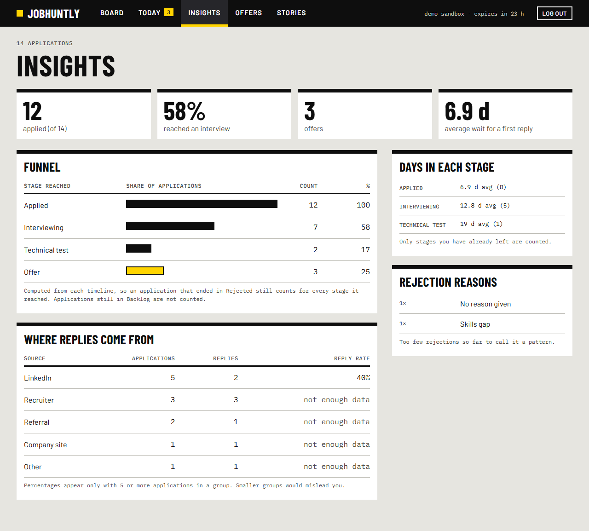
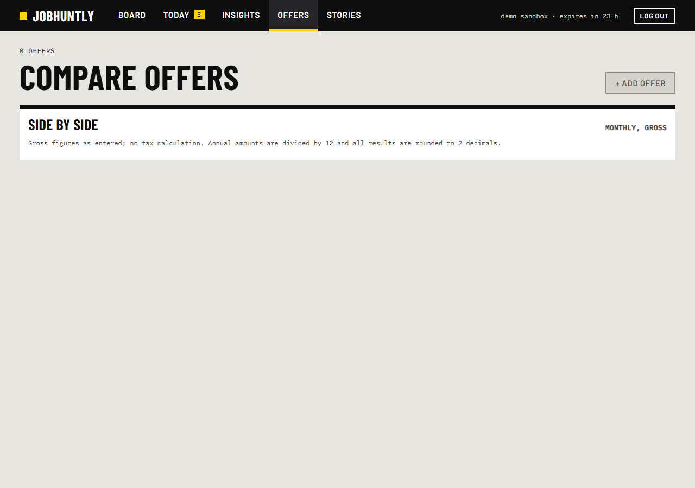

# JobHuntly

**An interview notebook for job seekers.** Most trackers store rows. JobHuntly shows what is next, helps you prepare each round, captures what happened right after, and tells you what your search is really saying.

> **Live demo:** [job-huntly-smoky.vercel.app](https://job-huntly-smoky.vercel.app/) (one click, no signup: a private sandbox with fictional data, deleted after 24 hours). The first request after a quiet period takes about 7 seconds while the free-tier server wakes up.



## What it does

- **Pipeline.** A six-stage board. Move a card with the stage menu (keyboard friendly) or by dragging it.
- **Today.** What needs you right now, computed by plain rules, no AI: an application with no news for 7 days, an interview in the next 48 hours with an incomplete checklist, a finished interview with no debrief.
- **Prepare.** A checklist for each round type (HR screen, technical, behavioral, take-home, final) and likely questions matched to your own STAR stories.
- **Debrief.** Write messy notes right after an interview; AI can organise them into what was asked, what went well, what went poorly and what to do next. You review before saving.
- **Insights.** A funnel computed from each application's **timeline**, so a rejected application still counts for every stage it reached. Reply rate by source (hidden below 5 applications, because a small sample misleads), days spent in each stage, rejection reasons.
- **Offers.** Compare offers in USD, GTQ and EUR on one table, with exchange rates you trust. Today's rate can be suggested from a public API, but it only fills the fields: the numbers never change under you.
- **Paste a job post.** AI drafts the form from the text. Nothing is saved until you press Create.
- **Try the demo.** One click opens a private sandbox with fourteen fictional applications, interviews, debriefs, offers and stories.

AI (Groq) is optional and always produces a **draft**. If the key is missing, the allowance is used up or the provider is down, the app keeps working by hand.

| Interview detail | Today | Insights | Offers |
|---|---|---|---|
|  |  |  |  |

## Design

"Wayfinding": the visual language of Swiss airport and station signage. Barlow type, black signage bars, a concrete background, and **one** signal colour, signage yellow, that always means "this needs you". Green is only for offers and red only for rejections, and every state also has a word, never colour alone. No gradients, no purple, no rounded-card template look. Mockups are in `docs/mockups/`.

## Stack

- **Frontend:** Next.js 16 (App Router), React 19, TypeScript (strict), one global stylesheet. No UI or state library.
- **Backend:** ASP.NET Core 8, Clean Architecture, EF Core, JWT in an `HttpOnly` cookie.
- **Database:** PostgreSQL (Neon).
- **AI:** Groq (`openai/gpt-oss-120b`), server-side only.
- **Tests:** xUnit (unit and integration against a real PostgreSQL), Vitest, Playwright with axe accessibility checks on desktop and a 375 px phone viewport.

How and why it is built, including the alternatives that were rejected: [docs/ARCHITECTURE.md](docs/ARCHITECTURE.md).

## Run it locally

You need .NET 8 SDK (or newer), Node 22+, and a PostgreSQL database. A free [Neon](https://neon.com) project works; use a development branch.

```bash
cp .env.example .env                                      # connection string, JWT secret, optional Groq key
cp jobhuntly-frontend/.env.example jobhuntly-frontend/.env.local

cd JobHuntlyBackend && dotnet run --project JobHuntly.Api      # API + Swagger on http://localhost:5070/swagger
cd jobhuntly-frontend && npm ci && npm run dev                  # app on http://localhost:3000
```

Set `BACKEND_URL=http://localhost:5070` in `jobhuntly-frontend/.env.local`. The database tables are created on the API's first start.

## Tests

```bash
cd JobHuntlyBackend   && dotnet test            # unit + integration (needs the database in .env)
cd jobhuntly-frontend && npm run check          # lint, types, unit tests
cd jobhuntly-frontend && npm run test:e2e       # builds the app and runs Playwright (desktop and mobile)
```

No automated test calls the internet: Groq and the exchange-rate service are replaced by fakes and a local mock. Checks against the real services are opt-in (`RUN_REAL_API_TESTS=1`).

## Deploying and what it costs

Backend on Fly.io (about **USD 2 a month**, only that), frontend on Vercel and database on Neon, both free. Step by step, with the honest cost notes and the limits: [docs/DEPLOYMENT.md](docs/DEPLOYMENT.md).

## Privacy and limits

- Text you paste into an AI feature is sent to Groq, a third-party provider. The app asks you to confirm this the first time you use AI.
- Demo sandboxes and everything in them are deleted after 24 hours.
- Offers are compared **gross, as entered**. There is no tax calculation.
- The free database sleeps when idle, so the first request after a quiet period is slower.

## How this project was built

Spec first: [principles](docs/00-principles.md), [spec with acceptance criteria](docs/01-spec.md), [plan](docs/02-plan.md) and [tasks](docs/03-tasks.md). Every acceptance criterion became a test. Contributing notes: [CONTRIBUTING.md](CONTRIBUTING.md).
