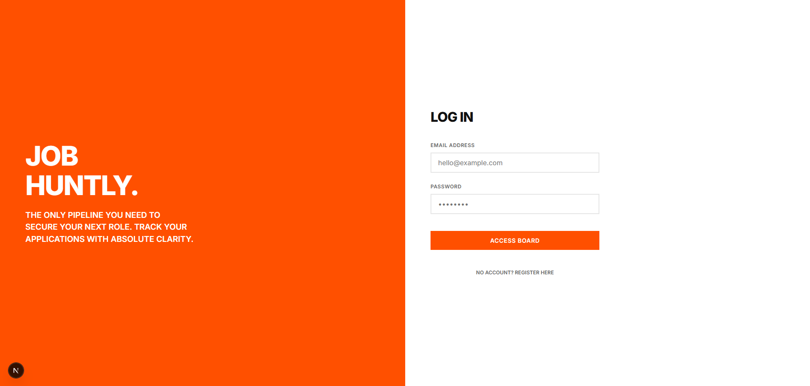
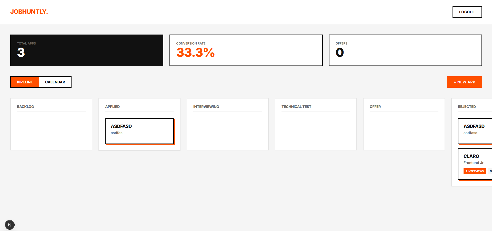
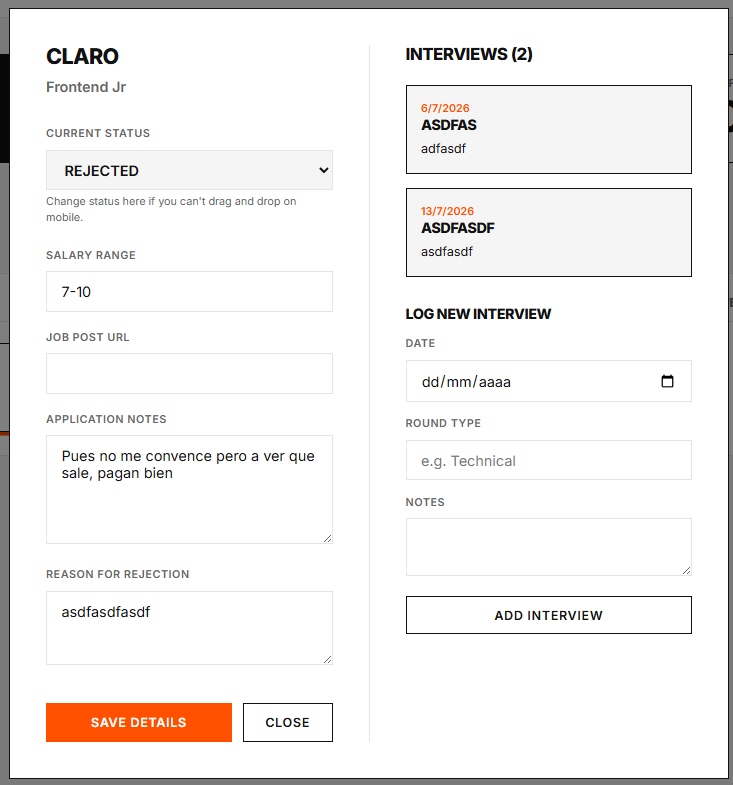

# JobHuntly

JobHuntly is a full-stack job application tracking system designed with a modern Swiss and Brutalist aesthetic. It helps job seekers organize their pipeline, track interview schedules, and analyze conversion metrics.

## Features

- Kanban Pipeline: Manage applications across different hiring stages.
- Interview Calendar: Monthly view to track upcoming technical and behavioral rounds.
- Analytics Dashboard: Real-time calculation of application conversion rates and offer counts.
- Responsive Design: Fully functional on mobile devices with adaptive layouts.
- Secure Authentication: JWT-based login and registration system.

## Screenshots

### Login and Registration

### Dashboard Pipeline

### Application Details and Interview Logging

## Technology Stack

### Frontend
- Next.js
- React
- Vanilla CSS

### Backend
- .NET 8 Web API
- Entity Framework Core
- SQL Server
- JWT Authentication

## Local Setup

### Prerequisites
- Node.js v20+
- .NET 8 SDK
- Docker

### Installation
1. Start the database using Docker Compose:
   \docker-compose up -d sqlserver2. Navigate to the backend directory, apply migrations, and run the API:
   \cd JobHuntlyBackend/JobHuntly.Api   \dotnet run3. In a new terminal, navigate to the frontend directory and install dependencies:
   \cd jobhuntly-frontend   pm install4. Configure the environment variables by creating a \.env.local\ file in the frontend directory:
   \NEXT_PUBLIC_API_URL=http://localhost:50305. Start the frontend development server:
   pm run dev
## Deployment
The backend includes a Dockerfile for deployment to container platforms or virtual private servers. The frontend is optimized for deployment on Vercel.
